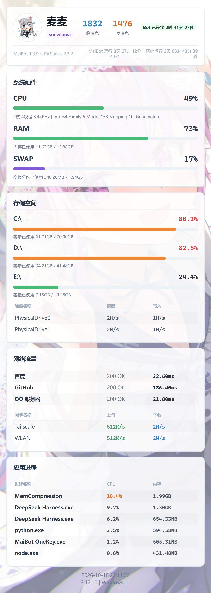

<div align="center">

# 📊 PicStatus-Re

**一张图看清机器人的全部运行状态**

[](https://github.com/Mai-with-u/MaiBot)
[](https://github.com/Mai-with-u/MaiBot)
[](#)
[](LICENSE)

</div>



---

## ✨ 功能特性

- 🖥️ **硬件监控**：CPU 占用 / 核心数 / 实时主频、内存、交换分区
- 💾 **存储空间**：各分区用量条 + 硬盘读写速率
- 🌐 **网络状态**：目标站点连通性与延迟、各网卡上传下载速率
- ⚙️ **应用进程**：按 CPU / 内存排序的进程占用列表
- 🤖 **机器人信息**：头像、收发消息计数、连接时长、运行时长
- 🎨 **模板化渲染**：Jinja2 模板 + Playwright 出图，中文不缺字、可自行换肤
- 🧩 **采集器插件化**：cpu / mem / disk / network / process / bot / misc，按模板声明按需采集
- 🖼️ **内置背景库**：自带多张背景图，支持启动预加载，避免每次渲染重新读盘

## 💬 使用指令

| 指令 | 说明 |
| --- | --- |
| `状态` | 生成设备状态图片（默认指令，可在配置中自定义） |
| `status` | 同上（英文别名） |

> `behavior.ps_only_su` 默认为 `true`：首次使用请先在 `admin.superusers` 填管理员 QQ，否则普通成员无法触发。
> 可选 `behavior.ps_need_at` 要求 @机器人 才触发。自定义 `ps_command` 后需重载插件生效。

## 🚀 快速安装

### 1. 放置插件

```text
MaiBot/plugins/WMX20081122_maibot-picstatus/
├── _manifest.json
├── plugin.py
├── config.py
├── collectors/
├── templates/
└── res/assets/          ← 内置背景图与默认头像
```

也可以直接在 **WebUI 插件市场** 搜索「PicStatus-Re」一键安装。

### 2. 安装依赖

```bash
pip install psutil py-cpuinfo jinja2 httpx playwright
playwright install chromium
```

### 3. 配置

复制 `config.example.toml` 为 `config.toml`（也可在 WebUI 插件配置面板里改）：

```toml
[behavior]
ps_command = ["状态", "status"]
ps_only_su = true
ps_need_at = false
ps_bot_qq = ""       # 填机器人 QQ 可跳过适配器直接取头像

[filter]
ps_ignore_parts = []    # 例：["^/boot", "^/efi$"]
```

### 4. 重载插件

保存后重载插件，在群里发送 `状态` 即可收到状态图。

## ⚙️ 配置说明

| 配置项 | 默认值 | 说明 |
| --- | --- | --- |
| `plugin.enabled` | `true` | 插件总开关 |
| `admin.superusers` | `[]` | 管理员 QQ 列表（`ps_only_su` 开启时生效） |
| `admin.nickname` | `[]` | 机器人昵称，卡片头像旁展示 |
| `behavior.ps_command` | `["状态","status"]` | 触发指令（纯文本完全匹配，修改后需重载插件） |
| `behavior.ps_only_su` | `true` | 是否仅管理员可用（默认开启） |
| `behavior.ps_need_at` | `false` | 是否需要 @机器人 才触发 |
| `behavior.ps_reply_target` | `true` | 是否回复触发者 |
| `behavior.ps_template` | `default` | 渲染模板名 |
| `behavior.ps_req_timeout` | `10` | 站点连通性测试超时（秒） |
| `behavior.ps_collect_interval` | `5` | 后台周期采集间隔（秒） |
| `behavior.ps_bot_qq` | 空 | 机器人 QQ 号，填写后直接走 qlogo 取头像 |
| `style.ps_bg_provider` | `local` | 背景来源：`local` 内置图 / `none` 无背景 |
| `style.ps_bg_preload_count` | `2` | 启动预加载的背景数量 |
| `filter.ps_ignore_parts` | `[]` | 忽略的磁盘分区正则（匹配挂载点） |
| `filter.ps_ignore_disk_ios` | `["^(loop\|zram)\d*$"]` | 忽略的磁盘 IO 设备正则 |
| `filter.ps_ignore_nets` | `["^lo(op)?\d*$\|^(Loopback\|本地连接)"]` | 忽略的网卡正则 |
| `filter.ps_ignore_procs` | `["^System Idle Process$"]` | 忽略的进程名正则 |

> 运行数据（背景预加载缓存）写入 Runner 分配的运行时目录 `ctx.paths.runtime_dir`，不会写进插件安装目录。

## 🎨 自定义模板

模板目录结构（以自带的 `default` 为例）：

```text
templates/
└── default/
    ├── __init__.py          # 组件声明 + 渲染入口
    └── res/
        ├── css/index.css
        └── templates/
            ├── index.html.jinja
            └── macros.html.jinja
```

复制一份 `default` 改个名字，把新目录名填到 `behavior.ps_template` 即可切换；改 CSS / Jinja 后重载插件生效。

## ❓ 常见问题

<details>
<summary>提示「获取运行状态图片失败」怎么办？</summary>

查看后台日志。最常见原因是缺少 Chromium：执行 `playwright install chromium` 后重载插件。

</details>

<details>
<summary>发「状态」没反应？</summary>

`behavior.ps_only_su` 默认开启，先把你的 QQ 填进 `admin.superusers`；若改过 `ps_command`，需重载插件让命令正则重新生成。

</details>

<details>
<summary>图片里中文变成方块？</summary>

本插件用 Playwright 直接渲染，走系统字体。Linux 请安装中文字体（如 `fonts-noto-cjk`、`fonts-wqy-zenhei`）。

</details>

<details>
<summary>机器人头像显示的是默认图？</summary>

两种方式任选：把 `behavior.ps_bot_qq` 填成机器人 QQ 号（直接走 qlogo API），或让适配器正常返回 `self_id`。

</details>

<details>
<summary>某些分区 / 网卡 / 进程不想显示？</summary>

在 `[filter]` 段配置过滤正则：`ps_ignore_parts`、`ps_ignore_disk_ios`、`ps_ignore_nets`、`ps_ignore_procs`。

</details>

## 🧱 环境要求

- MaiBot ≥ 1.3.0（当前声明兼容至 1.3.99），插件 SDK ≥ 2.12.0（兼容至 2.99.99）
- 适配器插件 [`maibot-team.snowluma-adapter`](https://github.com/Mai-with-u/MaiBot-SnowLuma-Adapter)
- Python 依赖：`psutil`、`py-cpuinfo`、`jinja2`、`httpx`、`playwright`（含 chromium）

> MaiBot 发布 1.4 后我们会跟进更新测试与区间声明。

## 📝 更新日志

### v2.3.3

- 背景预加载缓存改写入 Runner 分配的运行时目录 `ctx.paths.runtime_dir`，不再落到插件安装目录
- 修正 `_manifest.json` 版本区间：Host `1.3.0` – `1.3.99`，SDK `2.12.0` – `2.99.99`
- `behavior.ps_only_su` 默认改为 `true`
- 修复配置「配了不生效」：`ps_command` 按 `config.toml` 动态生成命令正则；`ps_req_timeout` 正确映射到站点测试超时；新增 `[filter]` 段透传过滤正则
- 清理不可启用的 `DebugFileWriter` 死代码；改用公开的 `self.ctx`，卸载时取消头像 / `self_id` 补全任务

## 🙏 致谢

- 原始项目：[nonebot-plugin-picstatus](https://github.com/yuexps/nonebot-plugin-picstatus) — 作者 [yuexps](https://github.com/yuexps)
- 本仓库为 MaiBot SDK 2.x 移植版，保留了原项目的渲染模板与采集器设计

## 📄 许可证

[MIT](LICENSE) © 2026 WMX20081122 · 原始项目版权归 yuexps 所有

<div align="center">

如果这个插件帮到了你，欢迎点一个 ⭐ Star

</div>
